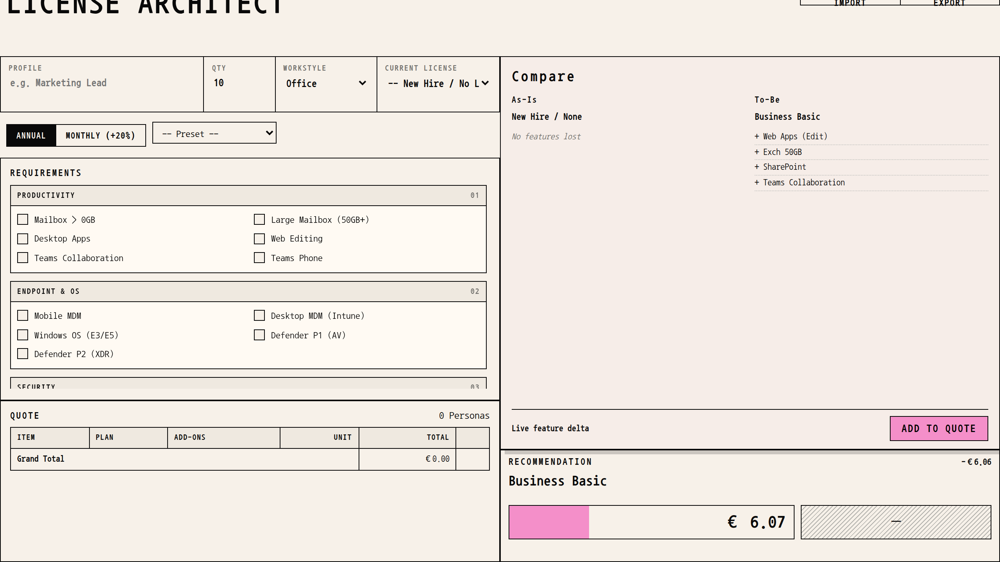
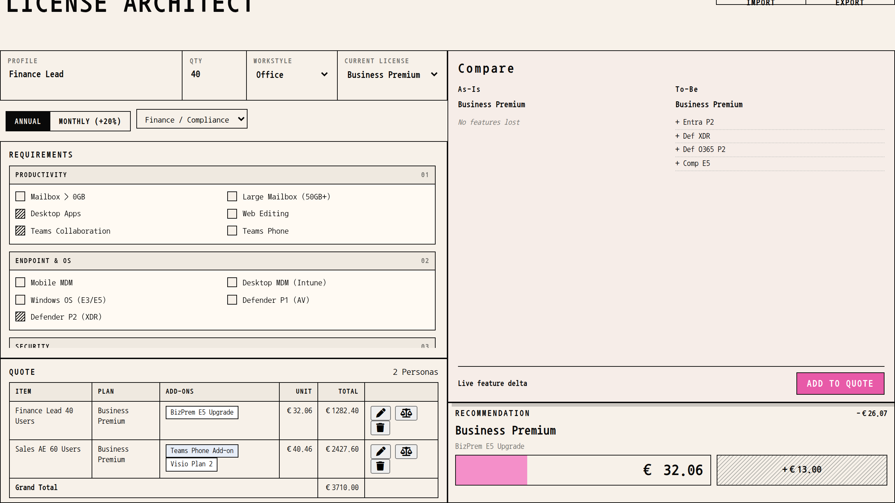
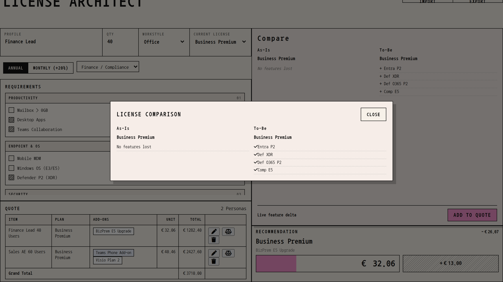
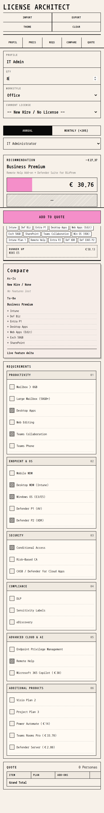

# License Architect

**Microsoft 365 licensing calculator for consultants and IT architects.**

License Architect turns persona requirements into a cost-aware SKU recommendation in real time — with Frontline guardrails, E5 break-even logic, Intune Suite optimization, EEA Teams pricing, and an As-Is / To-Be feature delta. The whole workshop flow stays on one page: profile → requirements → live recommendation → quote → CSV.



---

## Design

The UI is an **exposure-record workbench**: cream paper surface, iron-black rules, monospace type (Nanum Gothic Coding), hatch marks for selected requirements, and a single pink accent reserved for prices and primary actions. Numbers stay the visual focus — no glassmorphism, no dashboard chrome.

| Desktop workshop | Feature compare |
| --- | --- |
|  |  |

Mobile and tablet use a stacked layout with the recommendation and quote kept in reach:



---

## Key features

### Intelligent licensing engine
- **Frontline guardrails** — upgrades the base when a Frontline persona needs enterprise features (Desktop Apps, Windows OS, Teams Phone, …).
- **E5 break-even** — if Base + add-ons costs more than M365 E5, the tool recommends E5.
- **Intune Suite optimization** — compares individual Intune add-ons against the full Suite bundle.

### Pricing (EEA / Juli 2026)
- Base licenses support **with Teams** and **No Teams** variants; the Teams EEA add-on is applied only when needed.
- Covers Copilot, Intune Suite, Teams Phone, Defender for Business Servers, and more.
- Annual vs monthly (+20%) term switch.

### Comparison & quote
- Live **As-Is vs To-Be** feature delta next to the recommendation.
- Modal compare from any quote row (hierarchy-aware gained / lost features).
- Quote list with edit, grand total, CSV import / export.

---

## Tech stack

| Layer | Choice |
| --- | --- |
| UI | Vanilla HTML / CSS / JS in `index.html` |
| Engine | `src/engine.js` (`recommend`, `compare`) — no DOM |
| Data | `data/licenses.js` — prices, features, hierarchy, presets |
| Fonts | Local `fonts/NanumGothicCoding-*.ttf` |
| Icons / tips | Font Awesome, Tippy.js (CDN) |
| Tests | `node:test` under `test/` |

No backend. No build step for normal use. Open `index.html` in a modern browser (network needed for CDN assets).

---

## Project layout

```
index.html          UI, form handling, rendering, CSV
src/engine.js       Pure recommendation / compare logic
data/licenses.js    License catalog and persona presets
fonts/              Nanum Gothic Coding
test/               Regression + scenario tests
docs/screenshots/   README screenshots
```

---

## Usage

1. **Profile** — name, quantity, workstyle (Office / Frontline / Standalone), optional current license.
2. **Requirements** — toggle productivity, endpoint, security, compliance, and add-ons (or pick a preset).
3. **Recommendation** — read the live SKU, € price plate, and decision reason; check Compare for the feature delta.
4. **Add to Quote** — collect personas in the quote table.
5. **Export** — CSV for Excel / further processing. Import to restore a quote.

---

## Tests

```bash
npm test
```

Runs without extra packages and without network access. Also available as `npm run check`.

---

## Credits

Feature mapping draws heavily from [Aaron Dinnage / m365maps.com](https://m365maps.com/).

---

## License

MIT — see [LICENSE](LICENSE).

Copyright (c) 2025–2026 Leon Machnik
